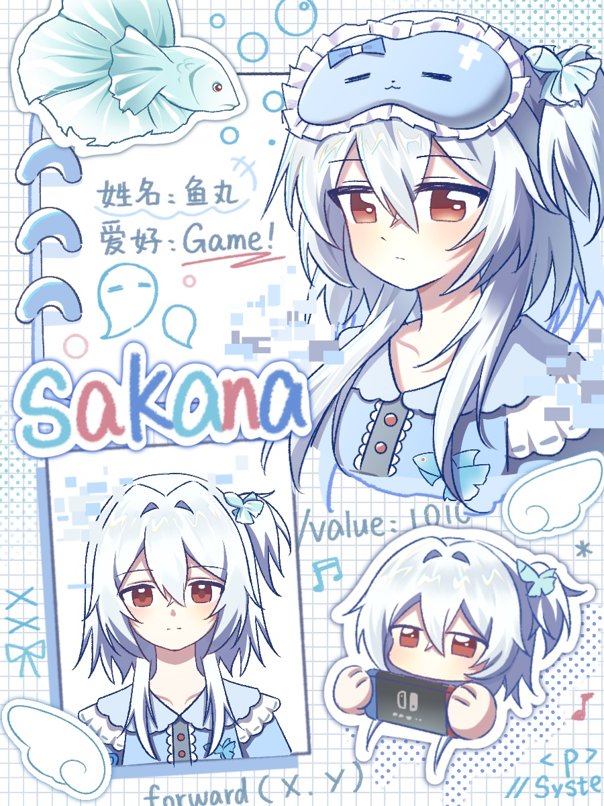
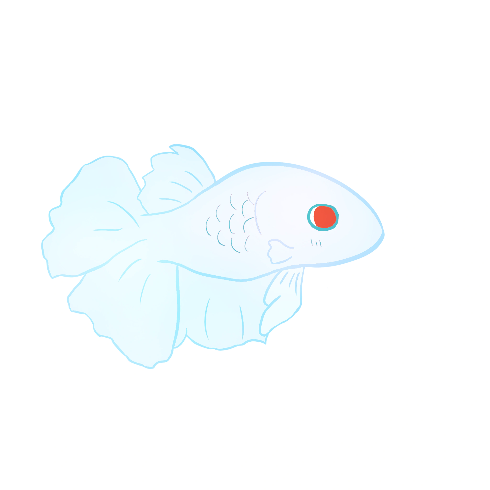

# 凪音澪 · Nagi Mio

**独立游戏开发者**

[主页](http://fish.kesug.com/) · [OC 展馆](http://blog.fish.kesug.com/) · [其他项目](https://gitee.com/fishfishh)

---

  
  

是一只互联网幽灵哦👻
养着一条白色斗鱼，也是唯一的编程同伴，它叫echo🐟️

### 技术栈

### 在做
（待更新）

---

๑₊————꒰ঌ  𝕹𝖆𝖌𝖎 𝕸𝖎𝖔 ໒꒱ྀི————๑₊⁺ 
๑₊————꒰ঌ  𝕰𝖈𝖍𝖔 ໒꒱ྀི————๑₊⁺
